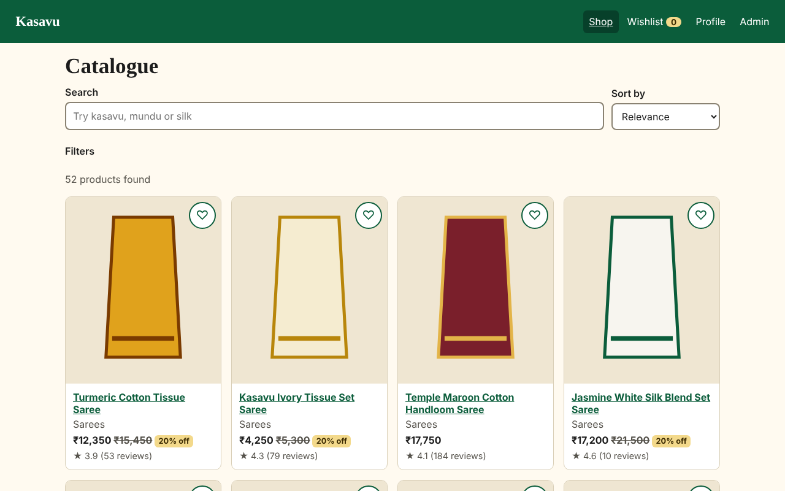
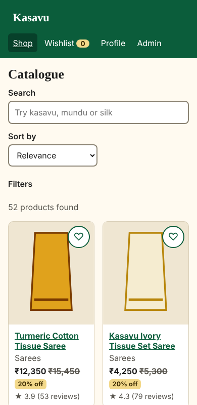
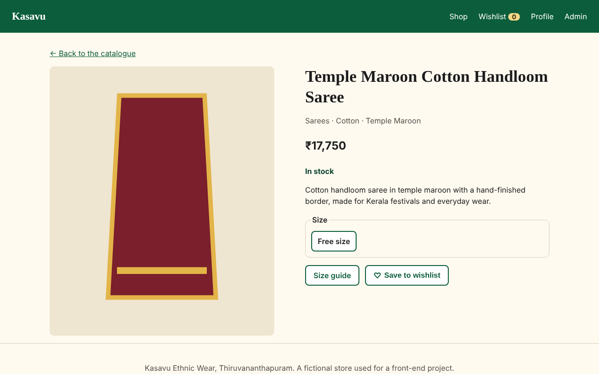
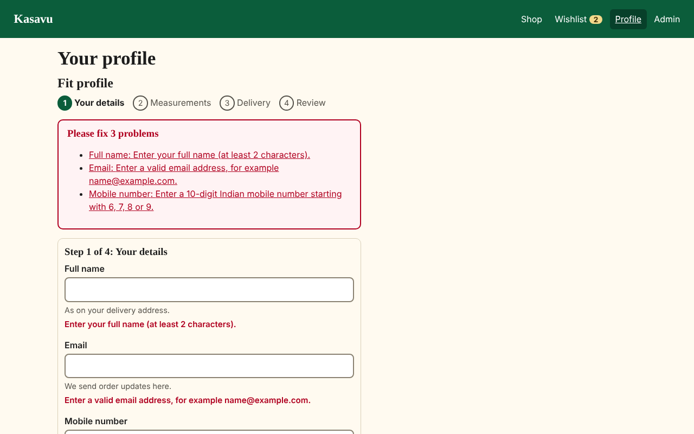
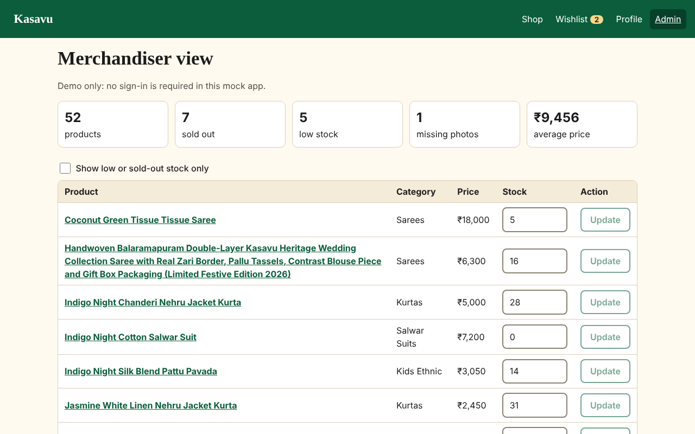
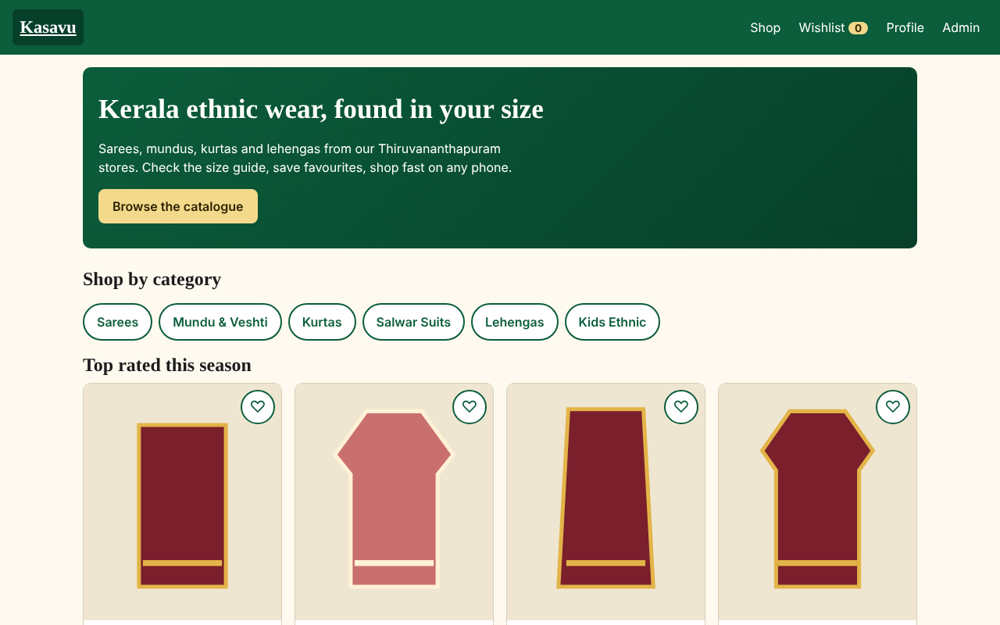

# Yuvaintern-project
an project for a fast, accessible React front end for a apparel catalogue with size guide and wishlist
# Kasavu Ethnic Wear Catalogue

React catalogue for a fictional Thiruvananthapuram ethnic-wear chain, with size guide and wishlist.

**Live URL:** _add after deploying to Netlify_








## Run

```bash
npm install
npm run dev
```

## What it has

- Search, filters, sort, pagination (state kept in the URL), with loading, empty and error states
- Product detail, size guide with size finder, wishlist (saved in localStorage)
- Multi-step profile form with accessible validation errors
- Admin view with inline stock editing
- Mock REST API (`src/mocks`) with edge cases: long name, missing image, sold out, empty category
- PWA offline support and lazy-loaded routes
- Wireframes: `docs/wireframes/` (6 screens). Test results: `docs/test-results.txt`

## Structure and state

`pages/` (screens) · `components/` (reusable UI) · `store/` (Redux Toolkit) · `mocks/` (API).

- Filters, sort, page: URL
- Catalogue results, wishlist, profile: Redux Toolkit
- Form drafts, dialogs: component state

## Deploy

Push to GitHub, import into Netlify (`netlify.toml` is set), paste the URL above.

Lighthouse (mobile, local build): performance 96 to 99, accessibility 100.
